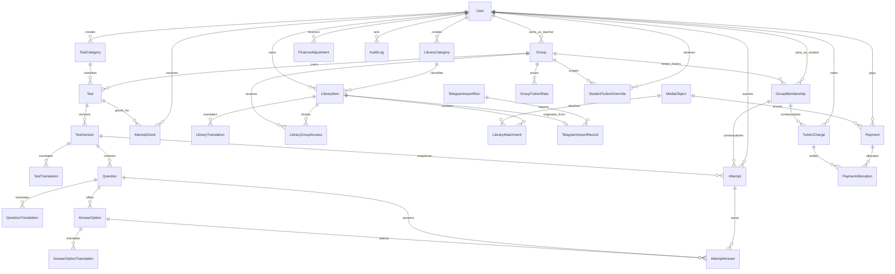

# BEST logical ERD draft

Status: approved on 2026-09-01 and implemented in the initial Prisma schema and
migration. The draft suffix is retained until PostgreSQL integration tests pass.

Auth.js account, session, and credential tables belong to milestone 4. This
draft defines the stable business identity as `User`; the auth schema will
reference that identity without changing the business ownership below.

## Domain ownership

### Identity and groups

- `User`: one role (`STUDENT`, `TEACHER`, or `ADMIN`) and one lifecycle state
  (`ACTIVE` or `INACTIVE`). `SUPER_ADMIN` is not included yet.
- `Group`: one owning Teacher, active/archive state, and payment deadline.
- `GroupMembership`: Student group history with start/end timestamps. A database
  constraint permits only one active membership per Student.

### Tests and attempts

- `Test`: stable identity owned by exactly one Group and one category.
- `TestVersion`: immutable published content and settings; draft edits produce a
  new version.
- Translation records: optional Uzbek, Russian, and English content with one
  required primary language.
- `Question` and `AnswerOption`: ordered, single-choice content with exactly one
  correct option enforced during publication.
- `Attempt`: start, expiry, auto-submit reason, `SUBMITTED` to `SCORED` worker
  lifecycle, score snapshot, pass threshold, and scoring-rule version.
- `AttemptAnswer`: autosaved selection; frozen after submission.
- `AttemptGrant`: Teacher-issued extra attempt for one Student and test.

### Library and one-time import

- `LibraryItem`: one category, one primary language, active/archive state, and
  `ALL_GROUPS` or `SELECTED_GROUPS` visibility.
- `LibraryGroupAccess`: selected group visibility. It is empty for
  `ALL_GROUPS` items.
- `MediaObject`: private object-storage metadata; binary data never enters
  PostgreSQL.
- `LibraryAttachment`: ordered PDF, image, audio, or video attachments.
- `TelegramImportRun` and `TelegramImportRecord`: one-time provenance and
  idempotency using unique channel ID plus message ID.

### Finance

- `GroupTuitionRate`: effective-dated monthly group price in whole UZS.
- `StudentTuitionOverride`: effective-dated Student-specific price.
- `TuitionCharge`: immutable monthly debt with due date and group-membership
  context.
- `Payment`: immutable `CASH` or `CARD` payment, optional card reference/receipt,
  and the Admin or owning Teacher who recorded it.
- `PaymentAllocation`: applies payments to charges; an unallocated remainder is
  Student credit.
- `FinanceAdjustment`: reasoned correction/reversal without rewriting history.

### Results and audit

- Progress and highest-score summaries are derived from immutable attempts;
  duplicate source-of-truth summary tables are not created initially.
- `AuditLog`: actor, action, target, timestamp, correlation ID, reason, and
  redacted old/new values for important changes.

## Constraints reserved for the physical schema

- One role per User and no `SUPER_ADMIN` in the first role enum.
- One active Group membership per Student.
- One Teacher owner per Group and one Group per Test.
- Unique test version number per Test.
- Exactly one correct option per published single-choice Question.
- One active attempt per Student and test version at a time.
- Unique Telegram channel/message source identity.
- Unique monthly charge per Student, group context, and billing month.
- Positive UZS amounts and valid percentage/day-of-month ranges.
- Immutable published versions, submitted attempts, charges, and payments.

## Explicitly deferred

- Auth.js accounts, sessions, login methods, and authorization guards: milestone 4.
- `SUPER_ADMIN` and permanent deletion/anonymization workflow.
- Multiple branches, multiple Teachers per Group, shared question bank,
  multiple-choice/free-text questions, and continuous Telegram sync.
- Provider-specific object-storage configuration until a maintained provider is
  selected.
